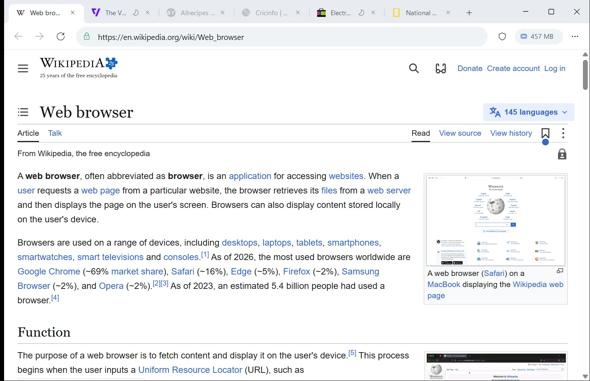

# Airy

A light, private browser for Windows 10 and 11. Background tabs sleep after 30 seconds, and ads and trackers are blocked by default.

**Website and download:** https://nishants-lab.github.io/airy/

With 8 busy tabs left idle for 60 seconds, Airy used 777 MB, Chrome 2,043 MB and Edge 1,460 MB (Task Manager, average of two runs). The website explains how this was measured.

| Download | What it does |
|---|---|
| [AirySetup-1.1.0.exe](https://github.com/nishants-lab/airy/releases/download/v1.1.0/AirySetup-1.1.0.exe) | Installs Airy for your Windows account, no administrator rights needed |
| [Airy-1.1.0-win-x64.zip](https://github.com/nishants-lab/airy/releases/download/v1.1.0/Airy-1.1.0-win-x64.zip) | Portable copy: extract and run `Airy\Airy.exe` |

Checksums are in [SHA256SUMS.txt](https://github.com/nishants-lab/airy/releases/download/v1.1.0/SHA256SUMS.txt). The downloads are not code-signed yet, so Windows SmartScreen may warn the first time; choose "More info", then "Run anyway".

**Updating:** run the new setup. It replaces the old version and keeps your tabs, bookmarks, settings and data. Every version is on the [release page](https://github.com/nishants-lab/airy/releases).

Found a problem? [Open an issue](https://github.com/nishants-lab/airy/issues).

This repository holds the website and the release downloads. Airy is free under the [MIT License](LICENSE). The website fonts, Instrument Serif and Figtree, are under the SIL Open Font License (see `assets/fonts/`).

## Tools

- `python tools/og.py` rebuilds `assets/og.png`, the link preview image, from `assets/hero.webp`.
- `python tools/preview.py [folder]` takes desktop and phone screenshots of `index.html` with headless Edge, to check the layout before a push.

Both need Python 3 with Pillow (`pip install pillow`). The fonts in `tools/fonts` are under the SIL Open Font License.
